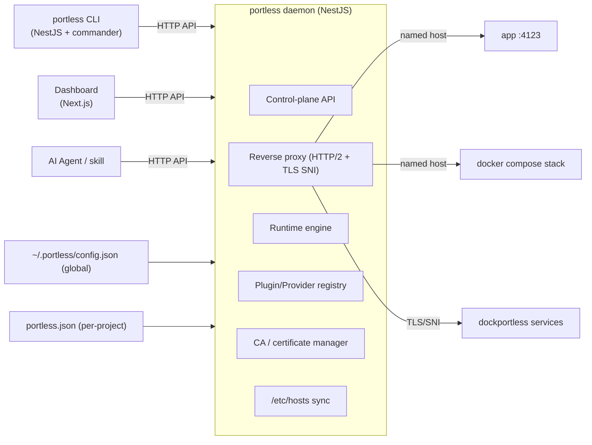
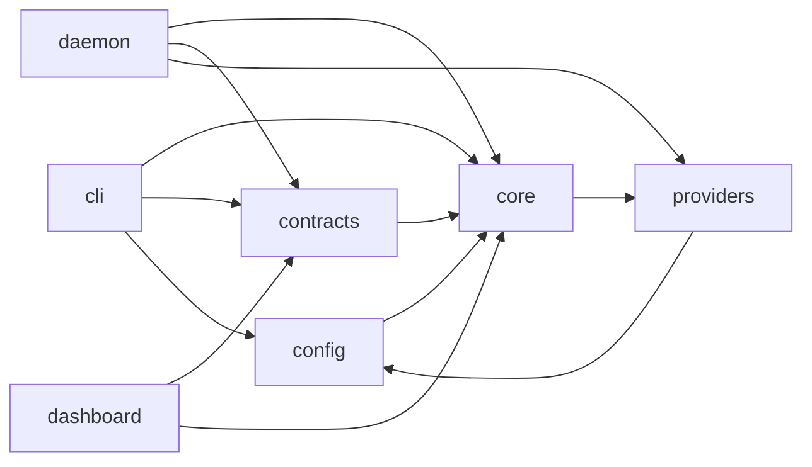

# Portless — Architecture

> Replace port numbers with stable, named `.localhost` URLs for local development —
> for humans **and** agents — now with a daemon, a dashboard, per-project/global
> configuration, Docker Compose support, and a pluggable provider model.

Portless is a **local development runtime** and **reverse proxy**. It maps stable,
named hostnames (e.g. `https://myapp.localhost`) to ephemeral or fixed ports bound by
your dev servers, containers, or any process. It is architected around a long-running
**daemon** (control plane + proxy engine) that all other surfaces — the **CLI**, the
**dashboard**, and **AI agents** — talk to over a local HTTP API.

---

## Goals

1. **Daemon-first.** A single long-running daemon owns every running app, route, cert,
   and configuration. The CLI is a thin client — it never "owns" a route; it *registers*
   it with the daemon.
2. **Compatibility with `vercel-labs/portless`.** The CLI command surface is a superset
   of the real tool (`run`, `<name> <cmd>`, `alias`, `list`, `doctor`, `trust`, `clean`,
   `prune`, `hosts sync|clean`, `proxy start|stop`, `service install|status|uninstall`,
   plus `PORTLESS_*` environment variables and the injected `PORT`/`HOST`/`PORTLESS_URL`
   children).
3. **Docker Compose + `mazrean/dockportless` support.** A `docker` provider parses
   `compose.yml`, assigns each service a free port, sets `<SERVICE>_PORT*` env vars, and
   starts the stack through the proxy — so `<service>.<project>.localhost` reaches each
   container. A first-class `dockportless` provider shells out to / emulates the
   `dockportless` binary for TLS-SNI routing of arbitrary TCP protocols.
4. **Configuration in two scopes.** A **global** config (`~/.portless/config.json`) and a
   **per-project** config (`portless.json` or the `"portless"` key in `package.json`).
   Configuration supports per-project environment variables and plugin settings.
5. **Pluggable.** The engine is provider/plugin driven. Adding a new way to launch or
   route traffic is a matter of implementing a `Provider` interface and registering it.
6. **Runs anywhere.** Works against plain command servers *and* docker-managed servers,
   orchestratable via the included `docker-compose` files.

---

## High-level architecture



### Process model

- The **daemon** binds two listeners:
  1. **Control plane** — a local HTTP/JSON API (default `127.0.0.1:PORTLESS_DAEMON_PORT`,
     default `4711`) used by the CLI, dashboard, and agents.
  2. **Proxy** — the reverse proxy (default port `443` with TLS, or `80` with `--no-tls`,
     or `7355` in compose/dockportless mode) that terminates HTTPS/HTTP/WebSocket and
     forwards to registered apps by hostname.
- The **CLI** connects to the daemon over the control plane. If the daemon is not
  running, the CLI starts it (or refuses in non-interactive/CI mode).
- **Children** (dev servers, `docker compose`, `dockportless`) are spawned by providers
  and registered in the daemon's route table.

---

## Monorepo layout

```text
portless/
├── apps/
│   ├── cli/          # the `portless` binary — NestJS + nest-commander (CLI surface)
│   ├── daemon/       # the control plane + proxy engine — NestJS
│   ├── dashboard/    # Next.js dashboard over the control-plane API
│   └── doc/          # Fumadocs documentation app
├── packages/
│   ├── config/       # portless config: global + per-project schema, discovery, env-per-project
│   ├── contracts/    # shared contracts for the control-plane API (routes, hosts, projects, plugins)
│   ├── core/         # protocol types, daemon client, proxy core, CA helpers, plugin API
│   ├── providers/    # pluggable providers: process, docker-compose, dockportless
│   └── configs/      # shared lint / ts / prettier configs
├── docs/             # deep-dive documentation
├── docker/           # compose files to run the whole stack
└── scripts/          # build / release tooling
```

### Dependency direction



Nothing in `core` depends on `apps/*`. `providers` depends only on `core` and `config`.
The `cli`, `daemon`, and `dashboard` are the composition roots.

---

## Control-plane API (summary)

The daemon exposes a JSON API under `/api/v1`:

| Resource | Methods | Purpose |
| --- | --- | --- |
| `/api/v1/health` | GET | liveness / version / proxy status |
| `/api/v1/routes` | GET, POST, DELETE | list / register / remove host→port routes |
| `/api/v1/apps` | GET, POST, DELETE | manage running apps (start/stop) |
| `/api/v1/projects` | GET | discover projects & workspace packages |
| `/api/v1/hosts` | GET, POST, DELETE | resolve & sync `/etc/hosts` entries |
| `/api/v1/config` | GET, PUT | read / update global config, per-project config |
| `/api/v1/plugins` | GET | list registered providers / plugins |
| `/api/v1/certs` | GET | CA status, refresh, trust |
| `/api/v1/events` | GET (SSE) | realtime event stream for the dashboard |

---

## Core concepts

### Route

A **route** binds a hostname to a target:

```ts
type Route = {
  host: string;          // "myapp.localhost"
  target: string;        // "127.0.0.1:4123"
  protocol: "http" | "tcp" | "tls"; // inferred by listener
  project?: string;
  source: "local" | "alias" | "docker" | "dockportless";
  tls: boolean;
  app?: AppRecord;
  createdAt: string;
};
```

### App

An **app** is a supervised child (or compose stack) registered with a route:

```ts
type AppRecord = {
  id: string;
  name: string;          // "myapp"
  command: string;       // "next dev"
  cwd: string;
  status: "starting" | "running" | "stopped" | "exited" | "error";
  pid?: number;
  port?: number;         // assigned port
  url: string;           // "https://myapp.localhost"
  provider: string;      // "process" | "docker" | "dockportless"
  env: Record<string, string>;
  startedAt?: string;
  stoppedAt?: string;
};
```

### Provider (plugin)

A **provider** is the pluggable unit. It knows how to *launch* something that binds to a
port, and how to *report* the resulting route. Providers are discovered at daemon startup
from the plugin registry and can be added without changing core:

```ts
interface Provider {
  readonly id: string;                      // "process" | "docker" | "dockportless" | ...
  readonly kind: "process" | "compose" | "external";
  detect(): Promise<boolean>;               // is this provider usable on this machine?
  start(app: StartAppRequest): Promise<StartAppResult>;
  stop(app: AppRecord): Promise<void>;
  list(): Promise<AppRecord[]>;
  describe(): ProviderInfo;
}
```

---

## Configuration

### Global config — `~/.portless/config.json`

```jsonc
{
  "version": 1,
  "tld": "localhost",
  "tls": true,
  "port": 443,
  "lan": false,
  "wildcard": false,
  "syncHosts": true,
  "daemonPort": 4711,
  "defaultProvider": "process",
  "providers": {
    "process":   { "enabled": true, "bin": "bun" },
    "docker":    { "enabled": true, "composeCommand": "docker compose" },
    "dockportless": { "enabled": true, "binary": "dockportless", "port": 7355 }
  },
  "env": {
    "NODE_ENV": "development"
  }
}
```

### Per-project config — `portless.json` (or `package.json#portless`)

```jsonc
{
  "name": "myapp",                 // inferred app name
  "script": "dev",                 // script to run
  "appPort": null,                 // fixed port, or auto-assign
  "proxy": true,                   // route through proxy
  "provider": "process",           // or "docker" / "dockportless"
  "compose": { "file": "compose.yml" },
  "env": { "MYAPP_MODE": "dev" },  // per-project env, merged over global
  "apps": {                        // monorepo overrides, keyed by relative path
    "apps/web": { "name": "web" },
    "apps/api": { "name": "api.myapp" }
  }
}
```

### Precedence (low → high)

1. Compiled defaults
2. Global config (`~/.portless/config.json`)
3. Per-project config (`portless.json` / `package.json#portless`)
4. Environment variables (`PORTLESS_*`)
5. CLI flags

### Environment injection into children

The daemon injects into every child:

```
PORT                             <assigned ephemeral port>
HOST                             <bind address, usually 127.0.0.1>
PORTLESS_URL                     <public URL, e.g. https://myapp.localhost>
PORTLESS_PROJECT                 <project name>
PORTLESS_ENV=<name>              <active env profile, if selected>
```

Docker provider additionally injects `<SERVICE_NAME>_PORT` (and `<SERVICE_NAME>_PORT_N`
for multi-port services), mirroring `dockportless`.

---

## Proxy engine

- HTTP/1.1 + HTTP/2 with `h2c`/`h2` and WebSocket (RFC 8441 extended CONNECT).
- On a connection, detect protocol:
  - **HTTP** → route by `Host` header.
  - **TLS** → terminate, read SNI, route by hostname, forward as plain TCP.
  - **PostgreSQL SSL** → detect `SSLRequest`, upgrade, route by SNI.
- `/etc/hosts` auto-sync for every registered hostname (disable with
  `PORTLESS_SYNC_HOSTS=0`).
- Local CA generated on first run, added to the OS trust store (`portless trust`).

---

## Security

- Proxy binds loopback only unless `--lan`.
- Control-plane API binds `127.0.0.1` only, and can require a token
  (`PORTLESS_DAEMON_TOKEN`) when the dashboard/CLI run on a different host.
- No credentials, API keys, or tokens are ever logged.

---

## See also

- `docs/` — deep-dive design notes
- `packages/config/README.md` — configuration reference
- `packages/providers/README.md` — provider / plugin authoring guide
- `apps/cli/README.md` — CLI reference
- `apps/daemon/README.md` — daemon & control-plane API
